# SysAdminHCP

**A modern, self-hosted web hosting control panel.**

🌐 [sysadminhcp.com](https://sysadminhcp.com) &nbsp;|&nbsp; 🔧 [microrepair.net](https://microrepair.net)

> **By downloading, cloning, installing, or otherwise using this software, you accept
> the terms of the [End User License Agreement](LICENSE.md).** SysAdminHCP is
> proprietary, commercial software distributed here as a compiled binary release —
> no application source code is included in this repository.

---

## What is SysAdminHCP?

SysAdminHCP is a full-featured hosting control panel for managing web servers, DNS,
mail, databases, and hosting clients from a single dashboard — self-hosted, single
binary, no external dependencies beyond the services it manages.

It runs directly on the server it manages (AlmaLinux 8/9/10 or Ubuntu 22.04+), driving
your existing Apache/Nginx, BIND, qmail, MariaDB, and Pure-FTPd stack rather than
replacing them, so you keep full control of the underlying system.

## Screenshots

| | |
|---|---|
| 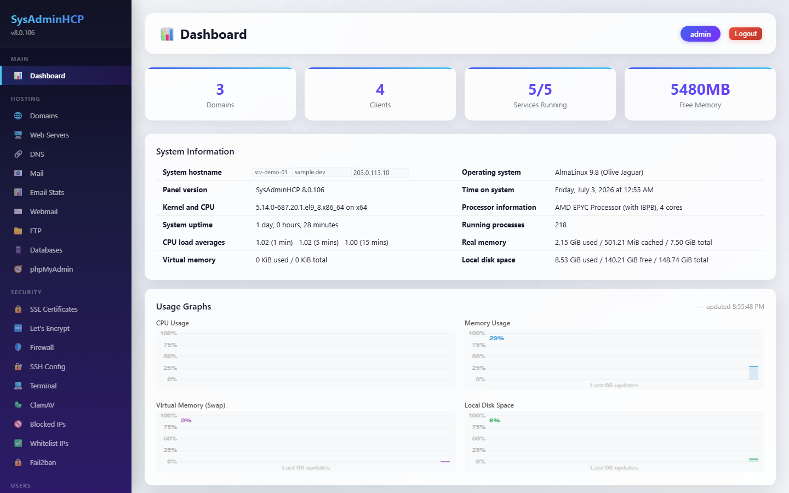 Dashboard | 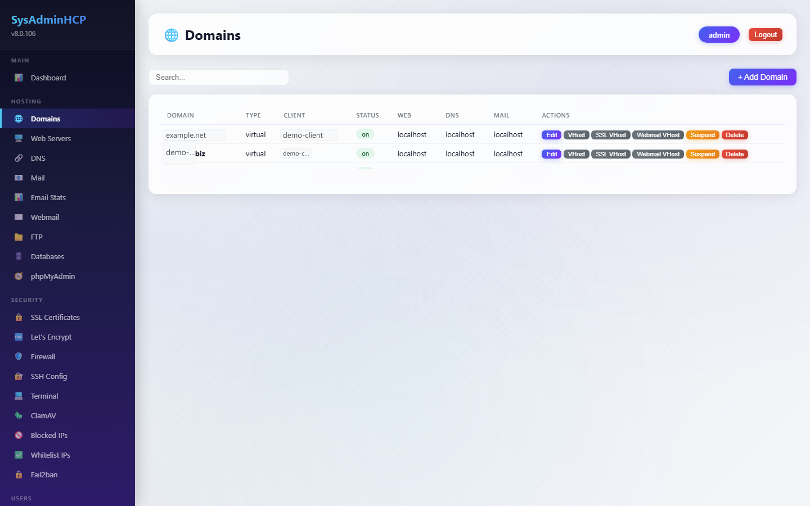 Domains |
| 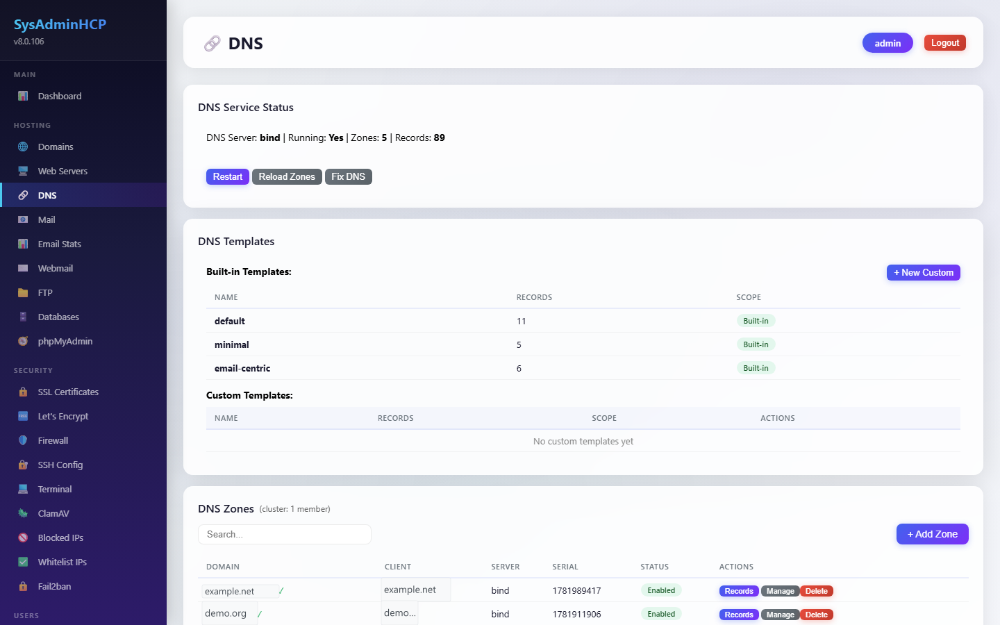 DNS Zones | 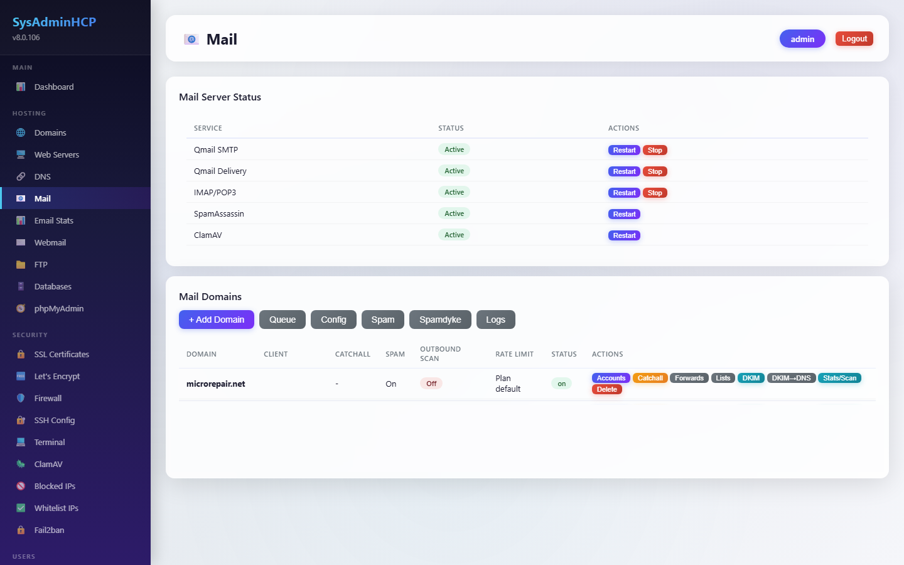 Mail |
| 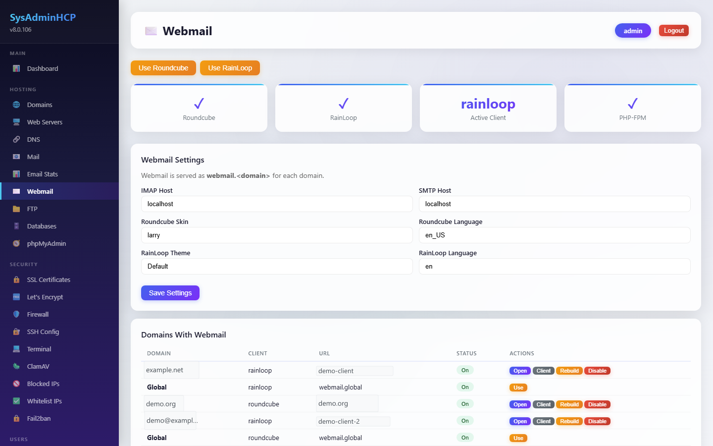 Webmail | 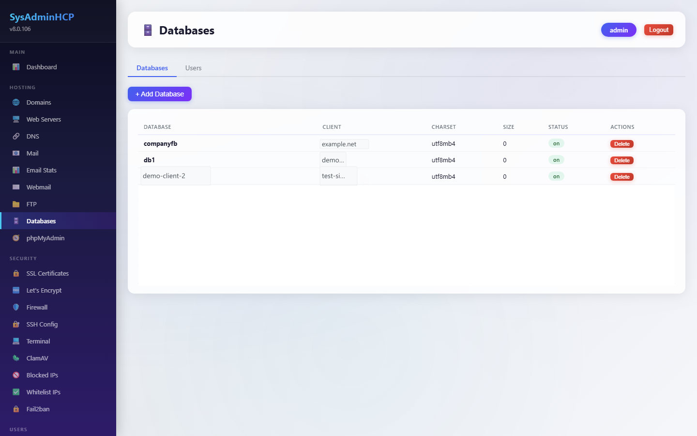 Databases |
| 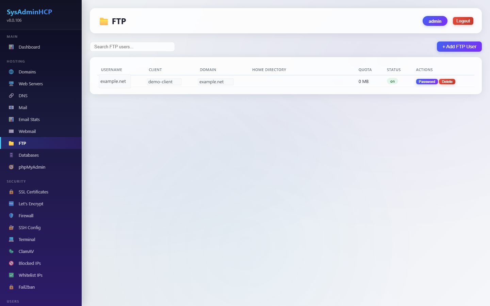 FTP Accounts | 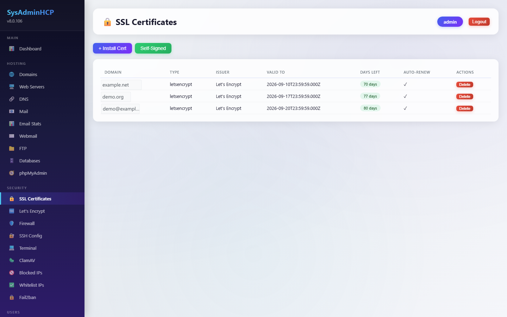 SSL / Let's Encrypt |
| 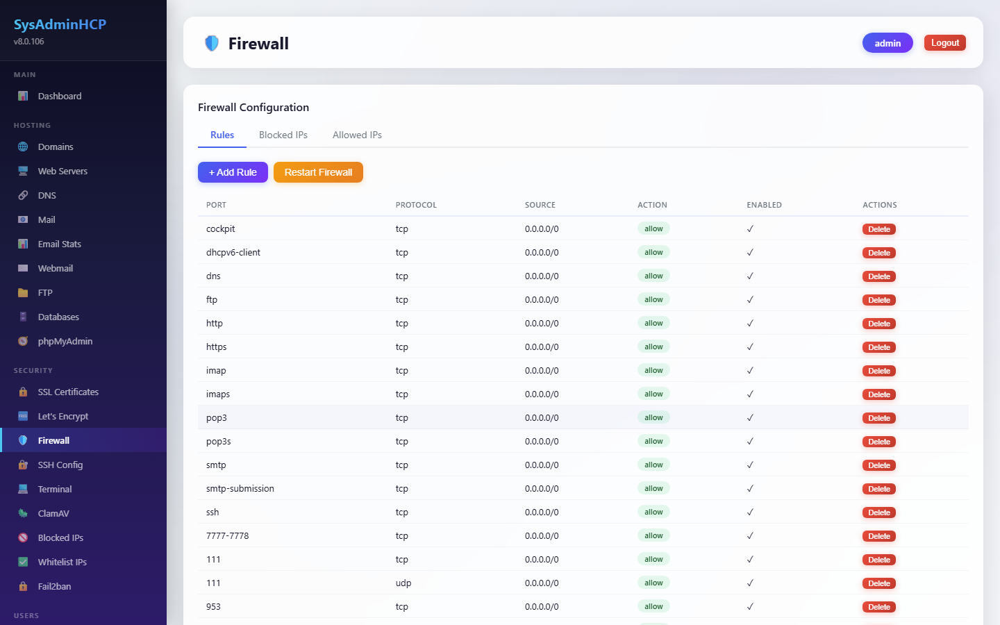 Firewall | 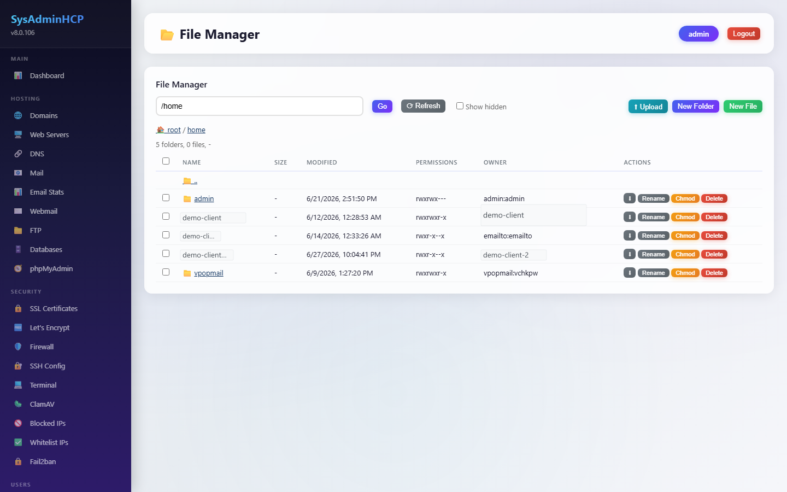 File Manager |
| 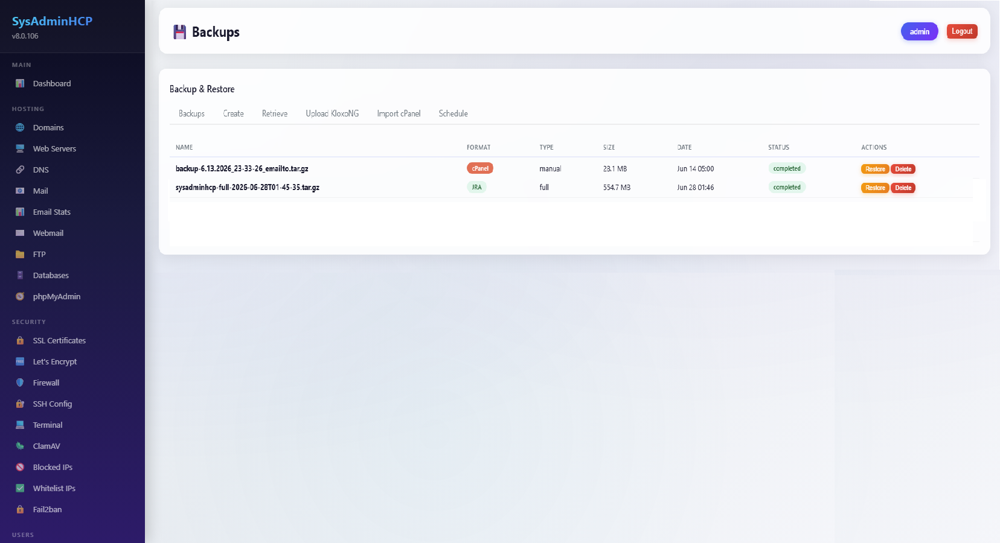 Backups | 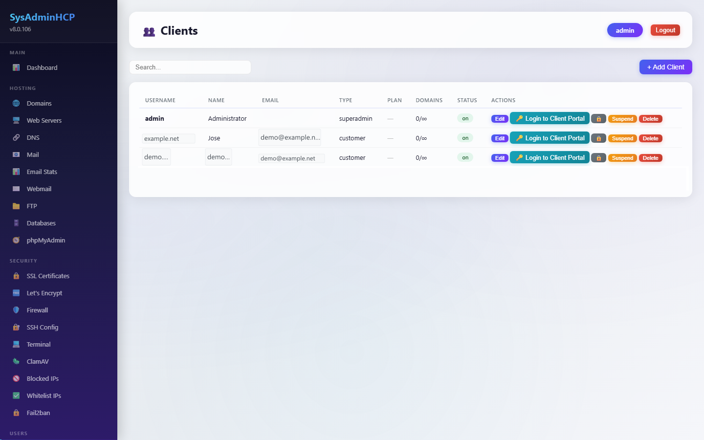 Client Management |
| 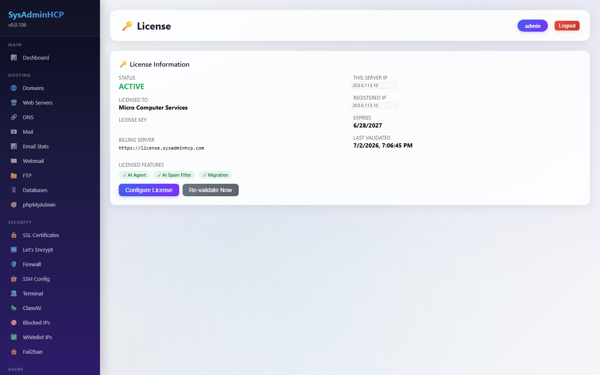 License | 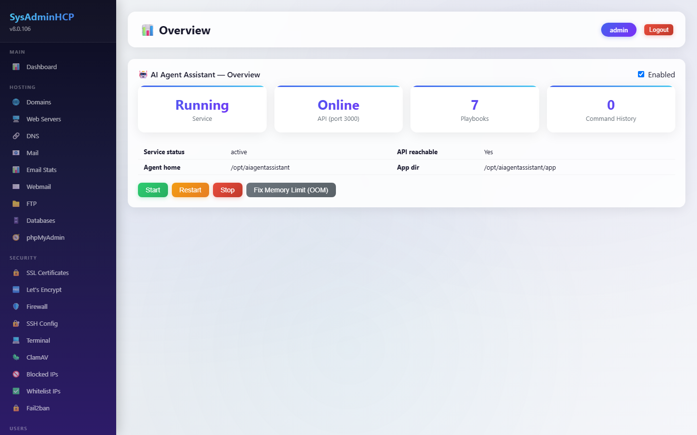 AI Agent (Pro) |
| 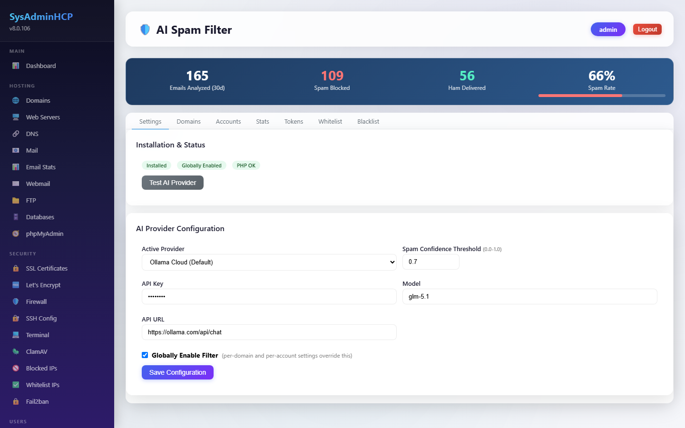 AI Spam Filter (Pro) | 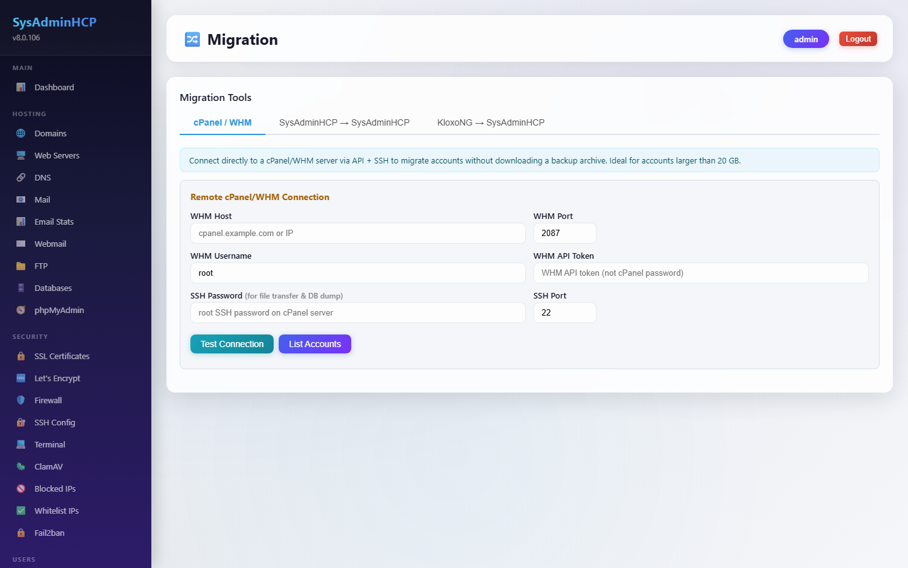 Migration Tools (Pro) |

## Features

- **Web hosting** — Apache, Nginx, Lighttpd, Hiawatha, and OpenLiteSpeed vhost management, PHP-FPM multi-version support, SSL/Let's Encrypt automation
- **DNS** — BIND, djbdns, MaraDNS, MyDNS, NSD, PowerDNS, and YADIFA zone/record management, bulk IP updates
- **Mail** — qmail-based mail server, mailboxes, forwards, mailing lists, webmail (RainLoop), spam whitelist/blacklist
- **Databases** — MySQL/MariaDB database and user management with phpMyAdmin single sign-on
- **FTP** — Pure-FTPd account management
- **SSL self-healing** — panel records, certificate files on disk and what the services actually serve are checked against each other; stale or missing certificates are repaired automatically and only what really needs it is renewed
- **Mail protection** — per-account daily SMTP sending limits (a stolen mailbox password can't flood the internet with spam), Spamhaus DQS key setting in the panel, per-domain mail TLS (SNI) and automatic DKIM
- **Security** — firewall management, IP whitelist/blacklist, Fail2ban, ClamAV, intrusion detection with auto-block, country blocking, two-factor login (TOTP) for admin and client portals
- **File Manager** — browser-based file management with proper Unix ACL/permission handling
- **Backups** — full client and domain backup/restore, including cPanel and KloxoNG import
- **Client Management** — multi-client hosting accounts with resource plans
- **Web Statistics** — GoAccess-powered traffic stats per domain
- **Cron Jobs** — admin cron manager for the server's scheduled tasks, plus per-client cron jobs in the client portal (always run as the client's own user, with admin limits)
- **Mail Deliverability Center** *(Pro)* — SPF/DKIM/DMARC checks with one-click DNS fixes, blocklist and provider-rejection monitoring with alerts, alternate outbound route, relay clients, and SRS for forwarded mail
- **Git Deploy** *(Pro)* — deploy a repository branch into a site folder by hand or on every push (signed GitHub/GitLab webhooks, per-deployment deploy keys, no `.git` folder in the website)
- **Offsite Backups** *(Pro)* — incremental, encrypted backups to SFTP, S3 or a REST server, with retention and restore to a side folder
- **Web Application Firewall** *(Pro)* — ModSecurity with the OWASP Core Rule Set, detect or block mode per server and per domain, events and rule exceptions for clients (Apache on AlmaLinux/RHEL)
- **Domain Transfer** *(Pro)* — move a domain with its files, mail, DNS, SSL, FTP, cron, Git deployments and databases to another client on the same server, with a verified database copy and automatic undo
- **AI Agent** *(Pro)* — AI-assisted SSH terminal and system administration from the browser, plus **Autonomous Mode**: continuous background monitoring of system health, support tickets, security activity, and backups, with specific actions (restart a service, reply to a ticket, retry a failed backup, etc.) available for delegation — every action stays off until explicitly enabled, each with its own confirmation
- **Compromised account lockdown** *(Pro)* — with Autonomous Mode on, a mail account that goes over its daily SMTP limit is locked automatically (SMTP, POP/IMAP and webmail), its live sessions are cut, and the mailbox owner, client and admin are notified
- **AI Spam Filter** *(Pro)* — AI-powered email spam filtering (Ollama Cloud, OpenAI, Claude, or Gemini providers)
- **Migration Tools** *(Pro)* — import hosting accounts from cPanel, KloxoNG, or another SysAdminHCP server
- **DNS Import & Multi-Server Sync** *(Pro)* — import zones from any remote BIND server (including split/`include`-based configs) and keep DNS in sync across a multi-server cluster
- **Signed updates** — panel releases are cryptographically signed and verified before they are applied; downloads are available only to licensed servers
- **Crash-safe database** — new installs use SQLite in WAL mode; re-running the installer keeps the database engine you already have

> **AI features require your own account with a compatible AI provider** (Ollama
> Cloud, OpenAI, Anthropic/Claude, Google Gemini, or GitHub Copilot — AI Agent only) — you supply
> the API key, and usage is billed by that provider, not SysAdminHCP. **Ollama
> Cloud is recommended**: it's inexpensive, supports the tool-calling AI Agent and
> Autonomous Mode needs, and an API key is quick to generate at
> [ollama.com/settings/keys](https://ollama.com/settings/keys) — the `glm-5.2:cloud`
> model is a strong default choice.

## Recent Highlights (v8.1.x)

- **8.1.1 — Clear Pro pages** — Pro pages show a clear Pro notice with a link to the License page on servers without a Pro license, and the client portal lists Git Deploy and Web Firewall only on Pro servers.
- **8.1.0 — Client portal hardening** — client-portal actions never build shell commands from text; the file manager works only on the client's own files, as the client's own Linux user; mail forwarders, FTP accounts, protected folders, error pages and redirects are validated.
- **8.1.0 — New features** — per-client cron jobs (Free and Pro), plus the Pro features Mail Deliverability Center, Domain Transfer, Git Deploy, Offsite Backups and Web Application Firewall (see Features).
- **8.1.0 — Cleaner client removal** — deleting a client also removes its Linux account when it is clearly a hosting account; site ownership stays with the client even when a single file can't be changed.

## Highlights (v8.0.48x)

- **8.0.487 — Security fixes** — client database passwords are escaped correctly; client-portal restore accepts only backups the server created for that client; remote-server API keys are encrypted at rest.
- **8.0.486 — Security hardening** — self-signed SSL creation runs without a shell; saved remote SSH passwords are encrypted; the AI Spam Filter defaults to Ollama Cloud.
- **8.0.485 — Installers keep your database engine** — re-running an installer no longer switches an existing server's database engine; new installs default to crash-safe SQLite (WAL).
- **8.0.484 — SSL self-healing** — expiry alerts based on stale records are gone; certificates renewed outside the panel are picked up, and missing or mismatched certificates are fixed automatically.
- **8.0.484 — Spamhaus DQS key in the panel** — enter your free Spamhaus DQS key once and the mail server uses it for RBL checks, with a safe default when no key is set.
- **8.0.480 — Quarantine filter fix** — spam/quarantine messages are always stored intact.

## Earlier Highlights (v8.0.19x)

- **Autonomous Mode expanded** — AI Agent monitoring now covers backups (overdue/failed detection, disk usage) and system resources (memory, disk), alongside the existing tickets/services/security scopes, each with its own opt-in delegated action.
- **Scheduled backups fixed end-to-end** — the backup schedule feature now actually runs on cron, on both traditional and single-binary installs, with correct retention pruning and a real timeout that can't leave a runaway process behind.
- **DNS Import fixed for split-config servers** — importing zones from panels that split `named.conf` across multiple included files (e.g. KloxoNG) now correctly discovers and imports them.
- **General CLI reliability fix** — command-line invocations (used by cron for backups, quota collection, etc.) now exit cleanly on completion instead of hanging.

## Free vs. Pro

| | Free | Pro |
|---|---|---|
| Price | $0 — lifetime | $66 / year (special price) |
| License scope | Unlimited installs (self-registered) | 1 host/IP per license |
| Hosting menu (Domains, Web Servers, DNS, Mail, FTP, Databases, phpMyAdmin, Webmail, Email Stats) | ✅ | ✅ |
| Backups (manual + scheduled, cPanel/KloxoNG import) | ✅ | ✅ |
| AI Agent (chat + Autonomous Mode monitoring/delegation) | ❌ | ✅ |
| AI Spam Filter | ❌ | ✅ |
| Migration Tools (cPanel / KloxoNG / SysAdminHCP) | ❌ | ✅ |
| DNS Import & Multi-Server Sync | ❌ | ✅ |
| Per-client cron jobs | ✅ | ✅ |
| Mail Deliverability Center | ❌ | ✅ |
| Domain Transfer between clients | ❌ | ✅ |
| Git Deploy | ❌ | ✅ |
| Offsite Backups (incremental, encrypted) | ❌ | ✅ |
| Web Application Firewall (ModSecurity + OWASP CRS) | ❌ | ✅ |

Mail Deliverability Center, Domain Transfer, Git Deploy, Offsite Backups and the Web Application
Firewall have always been Pro features, since they were introduced in 8.1.0.

Pro's $66/yr is a special price for orders placed by October 31, 2027 — that rate is
locked for 2 years from the date you order. Pro ordered after October 31, 2027 is $120/yr.
**Pro + Support** ($120/yr, $180/yr for orders after October 31, 2027) adds priority ticket
support and 4 remote-support incidents per year for control-panel issues. Pro and Pro + Support
are licensed per host / IP; final pricing is confirmed at checkout.

A license (Free or Pro) is required to unlock the Hosting menu — new installs get a
5-day grace period to register before it locks. Manage your license and upgrade to
Pro at [sysadminhcp.com](https://sysadminhcp.com).

## Installation

### Option A: One-line install (recommended)

Run this as root on a fresh AlmaLinux 8/9/10 or Ubuntu 22.04+ server:

```bash
curl -fsSL https://raw.githubusercontent.com/jorodriguezpr/sysadminhcp/main/autoinstall.sh | sudo bash
```

`autoinstall.sh` detects your OS, installs `git`/`git-lfs` if needed, clones this
repository to `/usr/local/src/sysadminhcp`, verifies the binary downloaded
correctly, and automatically runs the installer that matches your distro — no
manual steps required.

### Option B: Manual clone + install

If you'd rather review everything before running it:

```bash
# 1. Install prerequisites (git-lfs is required - the binary is stored via Git LFS,
#    without it you'll only get a pointer file, not the actual binary)
sudo apt-get update && sudo apt-get install -y git git-lfs   # Ubuntu/Debian
sudo dnf install -y git git-lfs                              # AlmaLinux/RHEL (EPEL may be needed)

# 2. Clone this repository
git clone https://github.com/jorodriguezpr/sysadminhcp.git
cd sysadminhcp

# 3. Run the installer that matches your OS
sudo bash deploy/install-almalinux8.sh     # AlmaLinux 8 / RHEL 8 clones
sudo bash deploy/install-almalinux9.sh     # AlmaLinux 9 / RHEL 9 clones
sudo bash deploy/install-almalinux10.sh    # AlmaLinux 10 / RHEL 10 clones
sudo bash deploy/install-ubuntu22.sh       # Ubuntu 22.04+ / Debian
```

Either way, the installer detects the pre-built binary automatically and installs
it directly — no TypeScript build, no compilation step. It sets up the full stack
(web server, DNS, mail, database, firewall) and starts SysAdminHCP as a systemd
service.

### First login

```
http://<server-ip>:7778/display
Username: admin
Password: admin
```

**Change the default password immediately after your first login.**

See [`deploy/README.md`](deploy/README.md) for detailed per-OS installer notes,
service management, and troubleshooting.

## License

SysAdminHCP is proprietary software. See [`LICENSE.md`](LICENSE.md) for the full
End User License Agreement, including Free/Pro terms, restrictions, and warranty
disclaimer.

## Links

- Product & licensing: [https://sysadminhcp.com](https://sysadminhcp.com)
- Support: [https://microrepair.net](https://microrepair.net)
